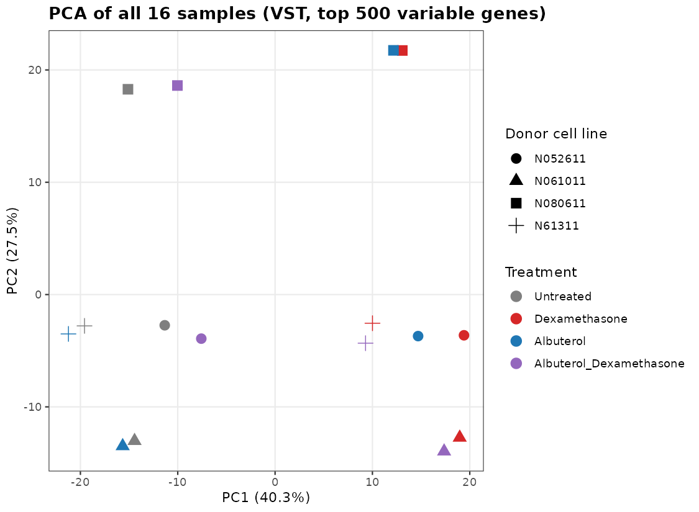
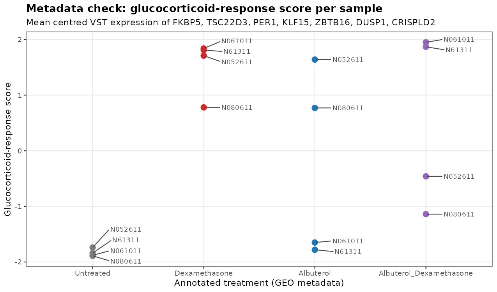
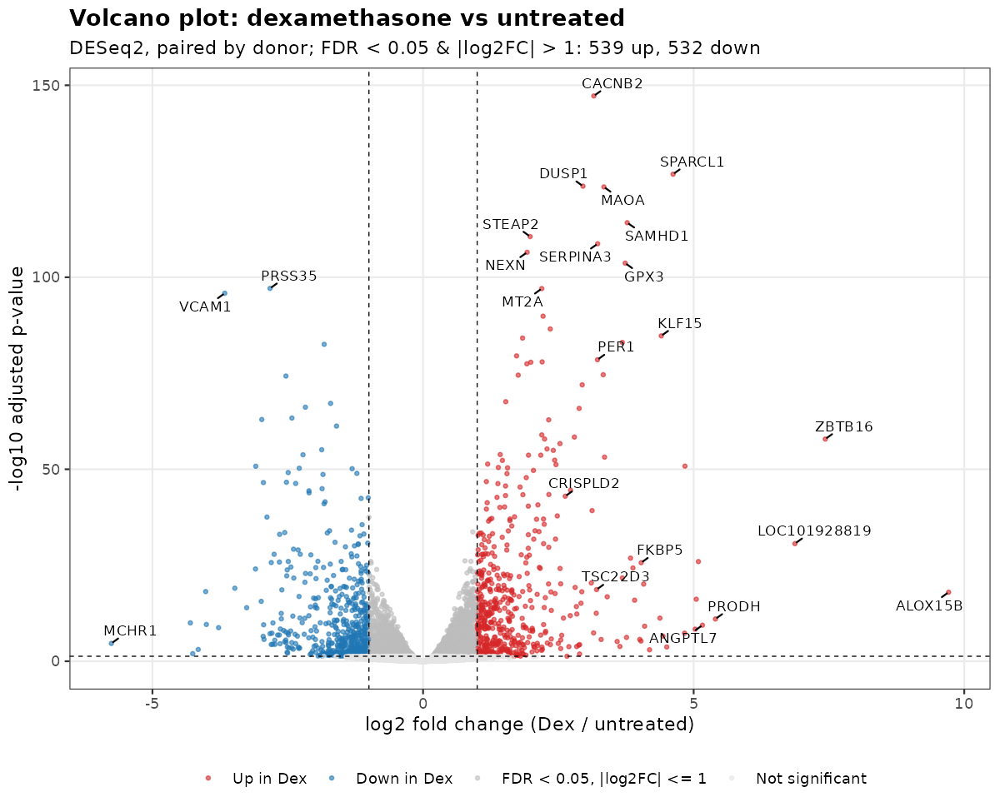
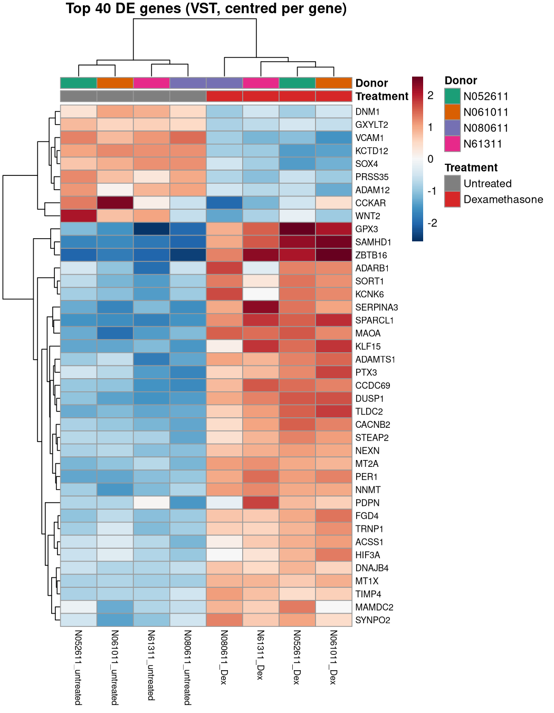
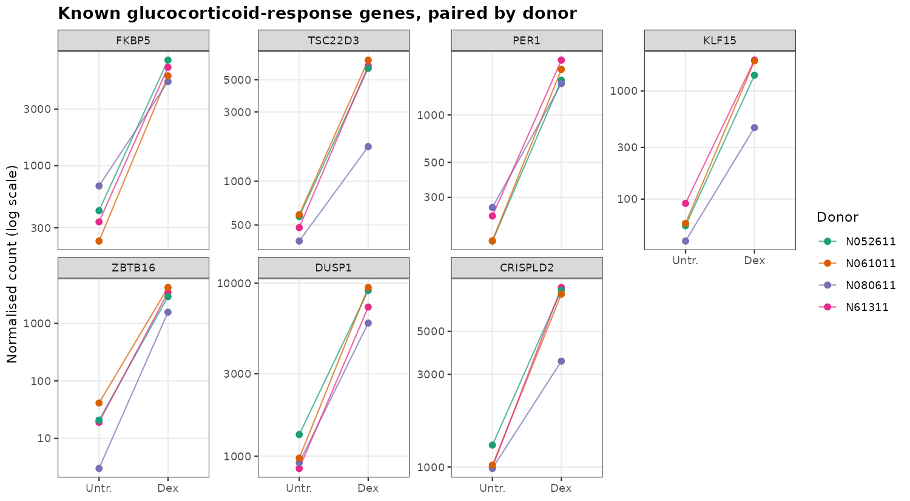
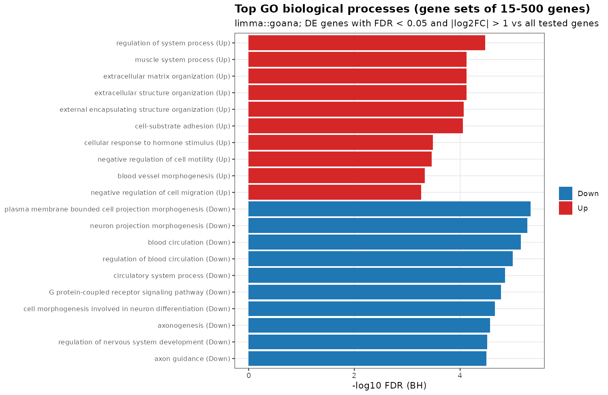

# Glucocorticoid response in human airway smooth muscle: RNA-seq differential expression

A reproducible R/Bioconductor workflow for bulk RNA-seq analysis: data download, QC, normalisation, differential expression with three methods (DESeq2, edgeR, limma-voom), visualisation, and GO enrichment. It is applied to a public dataset of human airway smooth muscle (ASM) cells treated with dexamethasone.

**Full report:** [`report/analysis.md`](report/analysis.md) (renders on GitHub) · [`report/analysis.html`](report/analysis.html) (self-contained HTML)

## Question

Which genes does the glucocorticoid **dexamethasone** regulate in primary human ASM cells, and does the response recover known glucocorticoid-receptor biology? Glucocorticoids are first-line anti-inflammatory therapy in asthma, and ASM is one of their target tissues.

## Data

| | |
|---|---|
| Accession | [GEO GSE52778](https://www.ncbi.nlm.nih.gov/geo/query/acc.cgi?acc=GSE52778) |
| Design | 4 primary ASM donor cell lines × 4 conditions (untreated, 1 µM dexamethasone, 1 µM albuterol, both; 18 h); 75 bp paired-end Illumina HiSeq 2000 |
| Counts used | NCBI GEO RNA-seq pipeline raw gene counts (GRCh38.p13, NCBI Gene IDs; 39,376 genes × 16 samples) |
| Primary comparison | Dexamethasone vs untreated, 4 donors (8 samples; the same samples as in the Bioconductor `airway` package) |

**Citation:** Himes BE, Jiang X, Wagner P, Hu R, Wang Q, Klanderman B, et al. *RNA-Seq transcriptome profiling identifies CRISPLD2 as a glucocorticoid responsive gene that modulates cytokine function in airway smooth muscle cells.* PLoS ONE. 2014;9(6):e99625. [doi:10.1371/journal.pone.0099625](https://doi.org/10.1371/journal.pone.0099625) (PMID 24926665)

The raw data are not committed; `R/00_download_data.R` fetches them from NCBI (about 0.75 MB).

## Methods

1. **QC (all 16 samples).** Library sizes, detected genes, count distributions before and after median-of-ratios normalisation, variance-stabilising transform (VST), PCA on the top 500 variable genes, sample-distance clustering, and a metadata check using a glucocorticoid-response score (mean centred VST expression of FKBP5, TSC22D3, PER1, KLF15, ZBTB16, DUSP1, CRISPLD2).
2. **Filtering.** Genes with ≥ 10 counts in ≥ 4 samples (16,802 genes tested).
3. **Differential expression.** DESeq2 with a paired design `~ cell_line + treatment`; Wald test; Benjamini–Hochberg FDR < 0.05; `normal`-prior LFC shrinkage for ranking and the MA plot. Cross-checked with edgeR (quasi-likelihood F-test) and limma-voom on the same design.
4. **Enrichment.** GO biological-process over-representation (`limma::goana`) for up- and down-regulated genes (FDR < 0.05, |log2FC| > 1) against all tested genes.

## Key findings

**1. A QC check found inconsistent labels in the albuterol arms.** All untreated and dexamethasone samples cluster as expected. In donors N052611 and N080611, however, the sample labelled "Albuterol" carries a strong glucocorticoid signature, and the sample labelled "Albuterol + Dexamethasone" does not. This is consistent with swapped or mis-annotated samples in the GEO metadata. Those arms were excluded, and the analysis focuses on the internally consistent dexamethasone vs untreated comparison.




**2. Dexamethasone produces a large, reproducible transcriptional response.** 4,743 genes are differentially expressed at FDR < 0.05 (2,557 up, 2,186 down). Of these, 1,071 change more than two-fold (539 up, 532 down). Treatment is the dominant axis of variation (PC1 ≈ 51% of variance in the 8-sample PCA).




**3. Canonical glucocorticoid targets are strongly induced in every donor**, which validates the analysis: FKBP5 (16-fold), TSC22D3/GILZ (9-fold), PER1 (9-fold), KLF15 (21-fold), ZBTB16 (173-fold), DUSP1/MKP-1 (8-fold). CRISPLD2, the gene highlighted by the original study, is induced 6.2-fold (FDR 1.1e-43). One donor (N080611) responds in the same direction but with smaller magnitude.



**4. Biology beyond the classic targets.** Repressed genes include VCAM1 (log2FC −3.7), with modest decreases in IL6 and CCL2. Up-regulated genes are enriched for extracellular-matrix organisation, cell–substrate adhesion and response to hormone stimulus. Down-regulated genes are enriched for GPCR signalling, blood-circulation and cell-projection morphogenesis terms. Together this points to effects on ASM structure and contractile signalling as well as inflammation (hypothesis-generating).



**5. The results do not depend on the method.** DESeq2, edgeR and limma-voom fold changes correlate at Spearman ρ = 0.998, and 4,628 genes are significant in all three methods.

All numbers above are generated by the code. See [`results/de_summary.csv`](results/de_summary.csv) and the full gene table in [`results/deseq2_dex_vs_untreated_all_genes.csv`](results/deseq2_dex_vs_untreated_all_genes.csv).

**Limitations:** 4 donors per group; a single dose and time point; GO over-representation depends on cut-offs and annotation bias; the albuterol arms were not analysed.

## Repository structure

```
.
├── R/
│   ├── install_packages.R           # CRAN + Bioconductor dependencies
│   ├── 00_download_data.R           # fetch counts + series matrix from NCBI GEO
│   ├── 01_prepare_data.R            # count matrix, sample table, gene annotation
│   ├── 02_qc.R                      # library QC, normalisation, VST, PCA, distances, metadata check
│   ├── 03_differential_expression.R # DESeq2 (primary), edgeR QL, limma-voom
│   ├── 04_figures_and_enrichment.R  # volcano, MA, heatmap, markers, concordance, GO
│   ├── utils.R                      # shared plotting helpers
│   └── run_all.R                    # runs the full pipeline and renders the report
├── report/
│   ├── analysis.Rmd                 # narrative report (reads results/ and figures/)
│   ├── analysis.md                  # GitHub-rendered output
│   └── analysis.html                # self-contained HTML output
├── figures/                         # all PNG figures
├── results/                         # DE tables, QC tables, GO results, sessionInfo
├── data/                            # raw/ and processed/ (populated by scripts, git-ignored)
├── LICENSE
└── README.md
```

## How to reproduce

Requirements: R ≥ 4.3 (tested on R 4.5.0 with DESeq2 1.46.0, edgeR 4.4.2, limma 3.62.2, org.Hs.eg.db 3.20.0).

```bash
git clone https://github.com/humbleambition/rnaseq-differential-expression.git
cd rnaseq-differential-expression
Rscript R/install_packages.R   # one-off
Rscript R/run_all.R            # download -> QC -> DE -> figures -> report (about 2 min)
```

Run all scripts from the repository root. Package versions used for the committed outputs are in [`results/sessionInfo.txt`](results/sessionInfo.txt). On Debian/Ubuntu the same packages are also available as system packages (`r-bioc-deseq2`, `r-bioc-edger`, `r-bioc-limma`, `r-bioc-org.hs.eg.db`, `r-bioc-go.db`, …).

## Author

Jennifer Hsieh, PhD (Neuroscience). Background in NGS and genomics R&D. Licensed under the MIT License.
