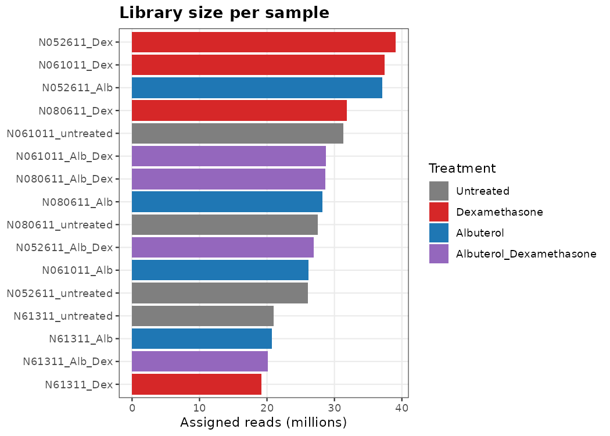
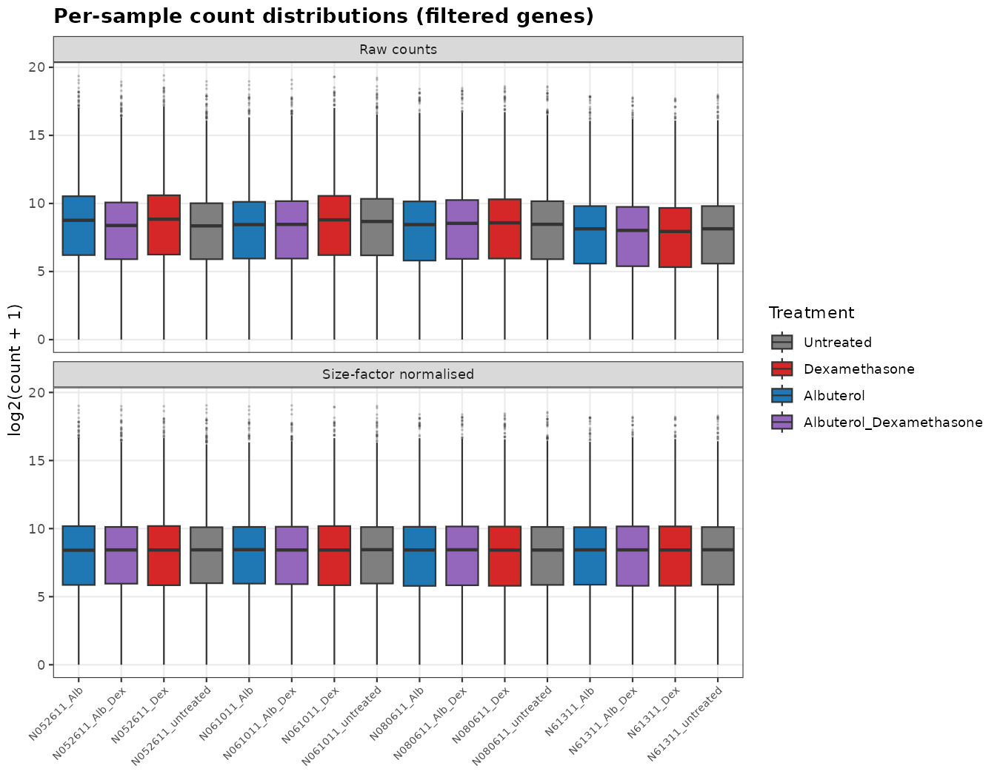
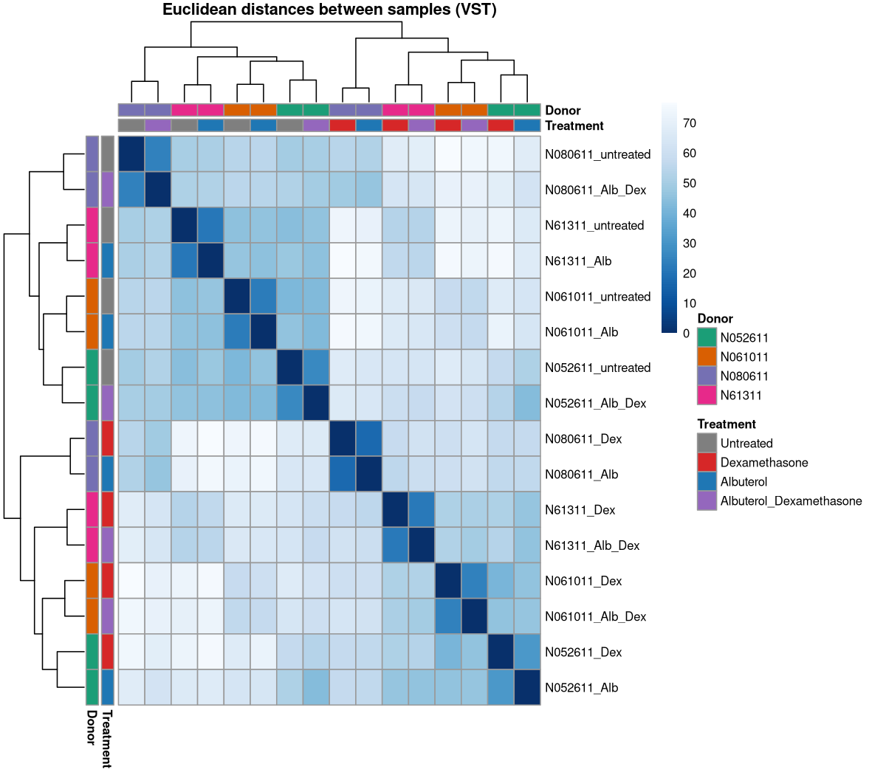
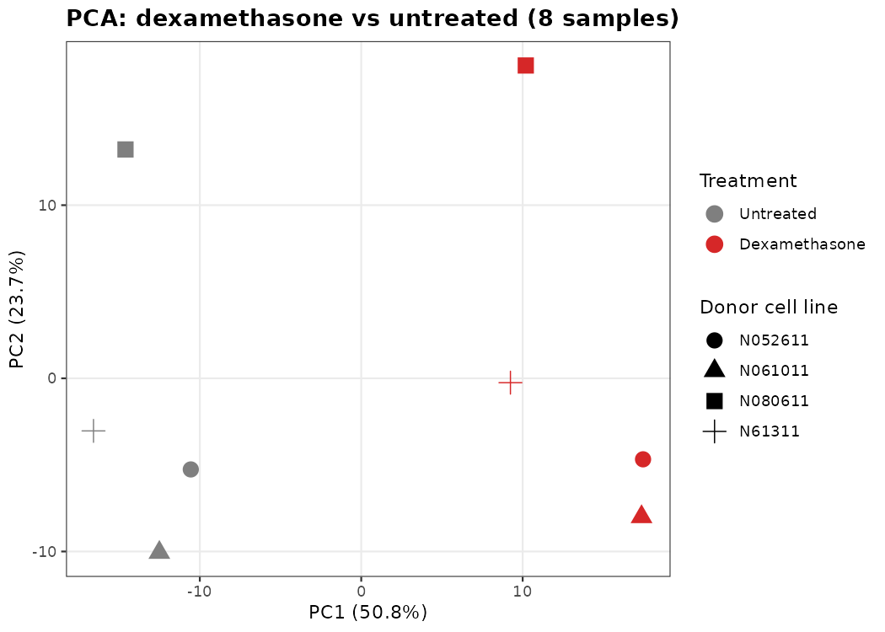
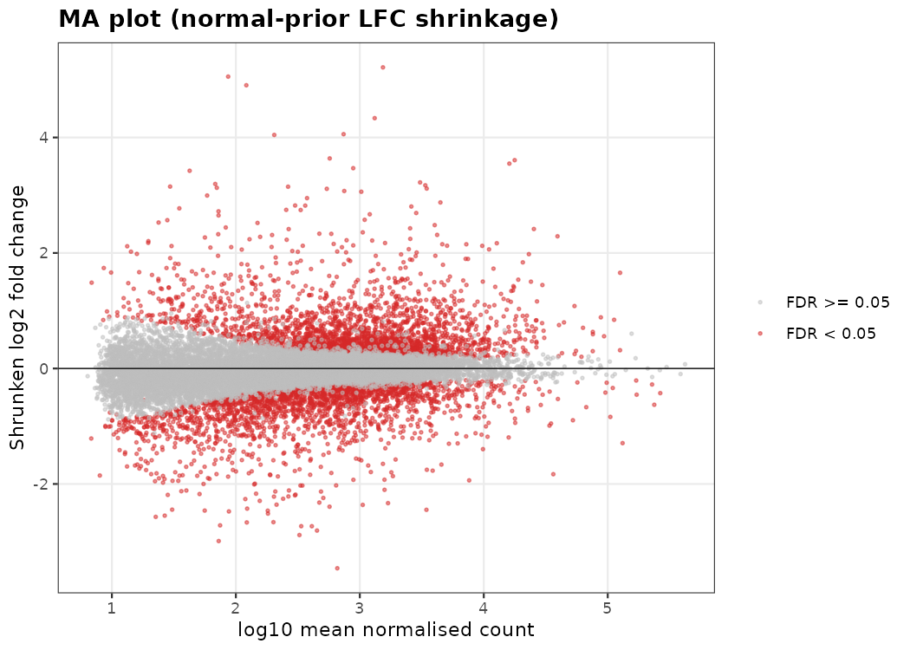
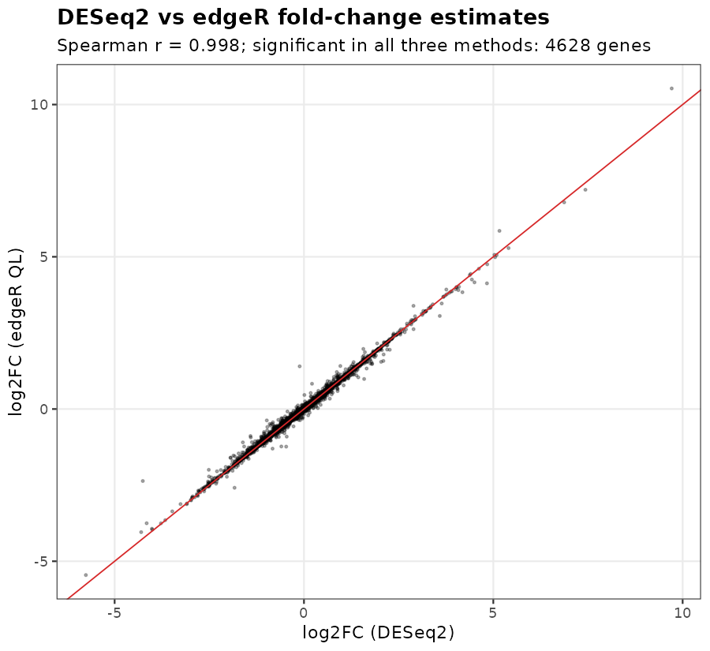

```{r setup, include = FALSE}
knitr::opts_chunk$set(echo = FALSE, message = FALSE, warning = FALSE)
res_dir <- file.path("..", "results")
rd <- function(f, ...) read.csv(file.path(res_dir, f), ...)
fmt <- function(x, d = 2) formatC(x, format = "f", digits = d, big.mark = ",")
lib  <- rd("qc_library_stats.csv")
sf   <- rd("qc_size_factors.csv")
pcv  <- rd("qc_pca_variance.csv")
gcs  <- rd("qc_glucocorticoid_score.csv")
summ <- rd("de_summary.csv")
de   <- rd("deseq2_dex_vs_untreated_all_genes.csv")
go   <- rd("go_bp_top_terms.csv")
sv   <- function(pattern) summ$value[grepl(pattern, summ$metric, fixed = TRUE)][1]
```

*This report summarises outputs generated by the scripts in `R/`. Re-run `Rscript R/run_all.R` to regenerate every number and figure.*

## 1. Question

Which genes respond to the synthetic glucocorticoid **dexamethasone** in primary human airway smooth muscle (ASM) cells, and does the response recover known glucocorticoid biology? Glucocorticoids are the mainstay anti-inflammatory therapy in asthma, and ASM is one of their target tissues.

## 2. Data

* **Study:** Himes BE et al. (2014) *RNA-Seq transcriptome profiling identifies CRISPLD2 as a glucocorticoid responsive gene that modulates cytokine function in airway smooth muscle cells.* PLoS ONE 9(6): e99625. doi:10.1371/journal.pone.0099625
* **GEO accession:** [GSE52778](https://www.ncbi.nlm.nih.gov/geo/query/acc.cgi?acc=GSE52778), 16 samples: four primary ASM donor cell lines, each untreated, 1 µM dexamethasone, 1 µM albuterol, or both (18 h).
* **Counts:** NCBI GEO RNA-seq pipeline raw gene counts (GRCh38.p13, NCBI Gene IDs), `r fmt(nrow(de), 0)` genes tested after filtering in the primary comparison.
* **Annotation:** `org.Hs.eg.db` (Entrez ID to symbol, name and gene type).

## 3. Quality control (all 16 samples)

Assigned reads per library ranged from `r fmt(min(lib$total_reads_M), 1)` to `r fmt(max(lib$total_reads_M), 1)` million, with `r fmt(min(lib$genes_ge10), 0)`-`r fmt(max(lib$genes_ge10), 0)` genes at ≥ 10 counts. DESeq2 median-of-ratios size factors ranged from `r fmt(min(sf$size_factor))` to `r fmt(max(sf$size_factor))`. No library was an outlier on depth or detected genes.





PCA on the variance-stabilised data (top 500 variable genes) separates samples into two groups along PC1 (`r pcv$percent_variance[1]`% of variance), while PC2 (`r pcv$percent_variance[2]`%) and PC3 largely reflect the donor cell line.




### Metadata check

PC1 should correspond to glucocorticoid exposure. All four untreated and all four dexamethasone samples fall where expected, but for donors **N052611** and **N080611** the sample annotated "Albuterol" clusters with dexamethasone-treated samples and the sample annotated "Albuterol_Dexamethasone" clusters with untreated samples. A score built from seven canonical glucocorticoid targets confirms this:

```{r gc-table}
knitr::kable(gcs[gcs$treatment %in% c("Albuterol", "Albuterol_Dexamethasone"), ],
             col.names = c("Sample", "Donor", "Annotated treatment", "GC score"),
             row.names = FALSE)
```


The pattern is consistent with swapped or mis-annotated albuterol samples in those two donors (the "Albuterol_Dexamethasone" samples also show a weaker, intermediate glucocorticoid signature). This analysis does not try to resolve it. **The albuterol arms are excluded**, and the primary comparison uses only the untreated and dexamethasone samples, whose labels are internally consistent. These are the same eight samples distributed in the Bioconductor `airway` package.

## 4. Differential expression: dexamethasone vs untreated

**Design:** `~ cell_line + treatment` (paired by donor), 8 samples. Genes were kept with ≥ 10 counts in ≥ 4 samples. DESeq2 Wald test, Benjamini-Hochberg FDR. Log2 fold changes were shrunk with the `normal` prior for the MA plot and ranking. edgeR (quasi-likelihood F-test) and limma-voom were fitted with the same design as cross-checks.

```{r summary}
summ_disp <- summ
summ_disp$value <- ifelse(summ$value %% 1 == 0, formatC(summ$value, format = "d", big.mark = ","),
                          formatC(summ$value, format = "f", digits = 3))
knitr::kable(summ_disp, col.names = c("Metric", "Value"), align = c("l", "r"))
```

In the 8-sample PCA, PC1 explains about half the variance and separates treatment; donor accounts for most of the rest.







### Top 15 genes by adjusted p-value

```{r top}
top <- head(de[!is.na(de$padj), c("symbol", "name", "baseMean", "log2FC", "padj")], 15)
top$baseMean <- round(top$baseMean)
top$log2FC <- round(top$log2FC, 2)
top$padj <- formatC(top$padj, format = "e", digits = 1)
knitr::kable(top, row.names = FALSE,
             col.names = c("Gene", "Description", "Mean count", "log2FC", "FDR"))
```

### Positive controls

```{r markers}
mk <- c("FKBP5", "TSC22D3", "PER1", "KLF15", "ZBTB16", "DUSP1", "CRISPLD2")
m <- de[match(mk, de$symbol), c("symbol", "log2FC", "padj")]
m$fold <- round(2^m$log2FC, 1); m$log2FC <- round(m$log2FC, 2); m$padj <- formatC(m$padj, format = "e", digits = 1)
knitr::kable(m[, c("symbol", "log2FC", "fold", "padj")], row.names = FALSE,
             col.names = c("Gene", "log2FC", "Fold change", "FDR"))
```


Donor N080611 shows the same direction of change for every marker but a smaller magnitude than the other three donors, which is visible also in its intermediate glucocorticoid score.

### Method concordance



## 5. Pathway-level view (GO biological process)

Over-representation analysis with `limma::goana` used genes at FDR < 0.05 and |log2FC| > 1, against all tested genes as the background, and was restricted for display to gene sets of 15-500 genes.

```{r go}
g <- go; g$FDR <- formatC(g$FDR, format = "e", digits = 1); g$ratio <- NULL
knitr::kable(g, row.names = FALSE, col.names = c("GO term", "Direction", "DE genes", "Set size", "FDR"))
```


## 6. Interpretation

* Dexamethasone produces a large, highly reproducible transcriptional response in ASM cells: `r fmt(sv("DESeq2 FDR < 0.05"), 0)` genes at FDR < 0.05, of which `r fmt(sv("|log2FC| > 1"), 0)` change more than two-fold, roughly balanced between induction and repression.
* The strongest hits recover canonical glucocorticoid-receptor targets: **FKBP5** (GR co-chaperone and negative-feedback regulator), **TSC22D3**/GILZ and **DUSP1**/MKP-1 (both key mediators of glucocorticoid anti-inflammatory action), **PER1**, **KLF15** and **ZBTB16**. **CRISPLD2**, the gene highlighted by the original study, is induced about `r fmt(2^de$log2FC[which(de$symbol == "CRISPLD2")], 1)`-fold, which reproduces the published finding.
* Repressed genes include the adhesion molecule **VCAM1** and modest decreases in the inflammatory cytokine genes **IL6** (log2FC `r fmt(de$log2FC[which(de$symbol == "IL6")])`, FDR `r signif(de$padj[which(de$symbol == "IL6")], 2)`) and **CCL2** (log2FC `r fmt(de$log2FC[which(de$symbol == "CCL2")])`, FDR `r signif(de$padj[which(de$symbol == "CCL2")], 2)`), consistent with the anti-inflammatory profile of glucocorticoids. Up-regulated genes are enriched for extracellular-matrix organisation, cell-substrate adhesion and response to hormone stimulus, and down-regulated genes for GPCR signalling and cell-projection morphogenesis terms. These suggest effects on ASM structure and signalling beyond inflammation.
* DESeq2, edgeR and limma-voom agree closely (Spearman ρ ≈ `r sv("DESeq2 vs edgeR")` for fold changes; `r fmt(sv("all three methods"), 0)` genes significant in all three), so the conclusions do not depend on the choice of method.

## 7. Limitations

* n = 4 donors per group. The paired design controls donor effects, but inter-individual variation in response (e.g. N080611) is only partly captured.
* A single dose and time point (18 h). Primary vs secondary response genes cannot be separated.
* GO over-representation depends on the significance and fold-change cut-offs and on GO annotation bias; it is hypothesis-generating.
* The albuterol and combination arms were not analysed because of the metadata inconsistency described in Section 3.

## Session information

```{r session}
sessionInfo()
```
